<p align="center">
  
</p>

<p align="center">
  <strong><a href="https://concord808030-tech.github.io/Ashframe/">Open the live demo →</a></strong>
</p>

<p align="center"></p>

## I. The darkroom

Ashframe is a small, growing collection of open-source photo tools, and each one works entirely on your own device. The first is the **Photo lab**, for black and white, film grain, scanlines and glitch. Lay a photograph on the table, turn the dials, watch the preview answer as you move, and export the print. All of it happens on an HTML canvas. Your images are never uploaded anywhere.

The home page is the catalogue of tools. More will arrive in time.

<p align="center"></p>

## II. What it does

- **Private by design.** Everything is processed locally. There is no server, no analytics and no external request.
- **Formats.** It opens JPG, PNG and WebP (drag and drop, file picker or paste) and exports PNG, JPEG or WebP.
- **Live preview.** You edit a scaled-down copy (1400 px at most), so the sliders stay responsive.
- **Full-resolution export,** capped at 4000 px on the long side.
- **Consistent results.** Effect sizes scale with the image, and grain and glitch draw from a seeded random generator, so the export keeps the look and layout of the preview.
- **Compare.** Hold the Compare button (or the `\` key) to see the original.
- **Reseed.** Pick a new random layout for grain and glitch.
- **A dark study.** The interface is dark only: walnut black, candle cream and brass, set in Cormorant Garamond and Hanken Grotesk.
- **The home page.** A black cat sits on a stack of books beside a folding camera. It blinks, swishes its tail, and fires the flash each time a new print develops. The prints are eight scenes painted in code (a library at midnight, a cloister, an observatory and more). Each one is developed through the lab's own pipeline into a toned plate, with soft rain falling behind the page. One button pauses all of it.
- **Accessible.** Lighthouse scores 100 for accessibility, best practices and SEO. The site works with a keyboard and with screen readers, has touch-sized controls on phones, and respects `prefers-reduced-motion`.
- **No build step.** It is plain HTML, CSS and JavaScript (ES modules).

<p align="center"></p>

## III. The effects

| Effect | Controls |
| --- | --- |
| Tone | Brightness, contrast |
| Black & white | Mix (luminance-based, Rec. 709) |
| Film grain | Amount, size (midtone-weighted monochrome noise) |
| Scanlines | Line count, opacity, thickness |
| Glitch | Slice count, shift, RGB channel split |

Every effect has an on/off toggle and a reset button. Double-click any slider to reset it.

Processing order: tone → glitch → B&W → scanlines → grain.

<p align="center"></p>

## IV. Developing locally

ES modules don't load from `file://`, so serve the folder with any static server:

```sh
# Python 3 (on Windows use `py` instead of `python`)
python -m http.server 8000
# or Node
npx serve .
```

Then open <http://localhost:8000> for the home page, or <http://localhost:8000/lab/> for the photo lab.

<p align="center"></p>

## V. Hanging it on the wall

To publish your own copy on GitHub Pages:

1. Push this repository to GitHub.
2. Go to **Settings → Pages**.
3. Under **Build and deployment**, choose **Deploy from a branch**, then **`main`** and **`/ (root)`**.
4. After a minute the site is live at `https://<your-username>.github.io/Ashframe/`. If you deploy a fork, update the demo link above.

The empty `.nojekyll` file tells Pages to serve the files as they are.

<p align="center"></p>

## VI. The archive

```
index.html            home page (wordmark, cat vignette, prints, tool list)
lab/index.html        the photo lab
css/base.css          shared design system: tokens, type, buttons
css/home.css          home page styles, including the vignette's motion
css/lab.css           photo lab styles
js/home.js            home page slideshow, rain and pause control
js/scenes.js          the eight procedural prints
js/rain.js            background rain
js/lab.js             photo lab UI wiring, preview loop, export
js/state.js           effect definitions and defaults
js/pipeline.js        shared render pipeline (preview + export)
js/image-io.js        decoding, scaling, encoding, download
js/rng.js             seeded PRNG
js/effects/*.js       one module per effect
js/fresh.js           registers sw.js
sw.js                 service worker: revalidates files after each deploy, caches nothing
assets/brand/         the cat-seal logo (logo.svg) and icons (favicon, Apple touch icon)
assets/fonts/         Cormorant Garamond and Hanken Grotesk (self-hosted, SIL Open Font License)
assets/readme/        the banner and divider for this README
docs/ARCHITECTURE.md  how it works, and how to write an effect
```

To add an effect, write a function `(imageData, params, rand) => void` in `js/effects/`. Then register it in `ORDER` in `js/pipeline.js` and add its sliders to `EFFECTS` in `js/state.js`. The panel builds itself from those definitions. See **[docs/ARCHITECTURE.md](docs/ARCHITECTURE.md)** for the full walkthrough.

<p align="center"></p>

## VII. Contributing

Pull requests are welcome. Please read **[CONTRIBUTING.md](CONTRIBUTING.md)** first: no dependencies, no network requests, and the export must match the preview.

Personal files are kept out of git. Test photos go in `/samples/`, `/test-images/` or `/private/`, which are ignored. The `.gitignore` also excludes AI-assistant folders (`.claude/`, `.codex/`, `.cursor/`, …), editor settings, OS clutter and common secret files.

<p align="center"></p>

## VIII. Licence

MIT. See [LICENSE](LICENSE). The fonts are under the SIL Open Font License; see `assets/fonts/`.
